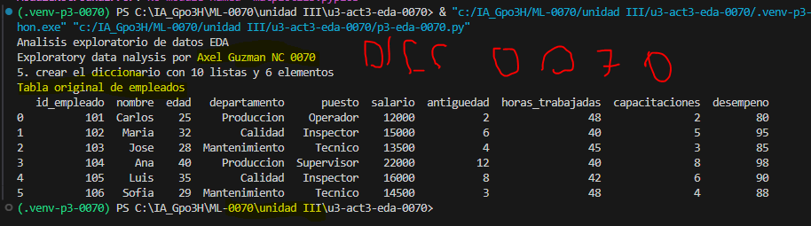
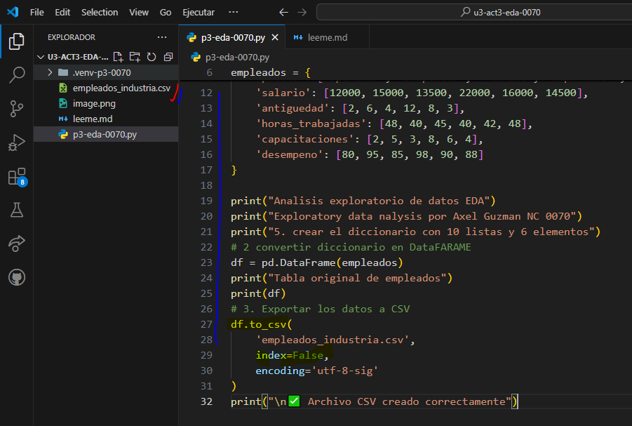
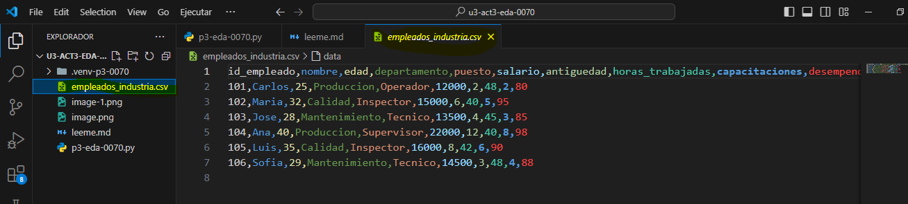

# 📊 UIII Act3: Importación y Descripción de Datos
## Axel Guzman NC 0070
> **📈 Dificultad:** Cero a principiante  
> **🐍 Lenguaje:** Python  
> **🛠️ Herramientas:** Visual Studio Code, Pandas, Matplotlib y CSV  
## tabla original de empleados

## 7 convertir el dataframe en arcivo CSV

## datos en CVS > base de datos
