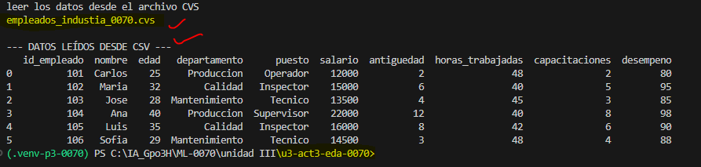
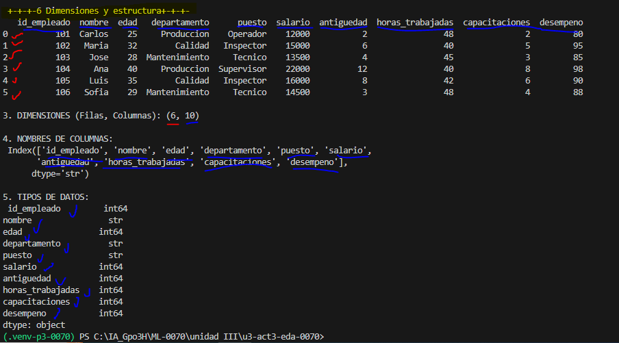
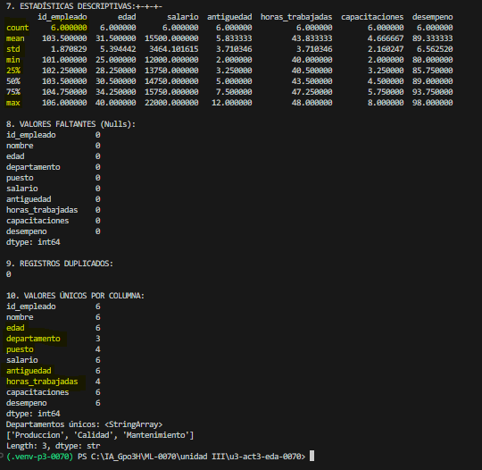
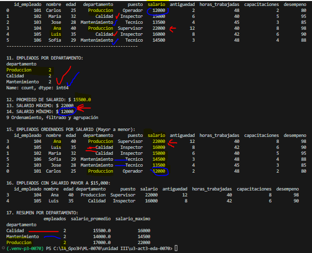
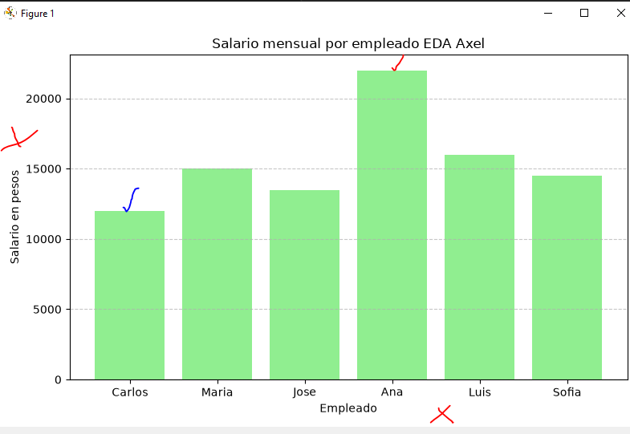
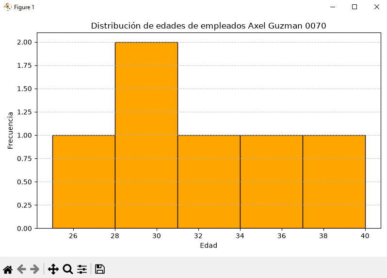
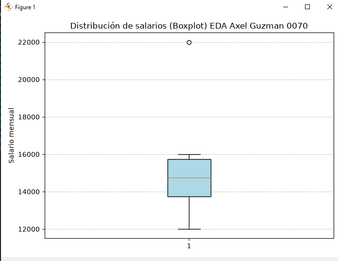
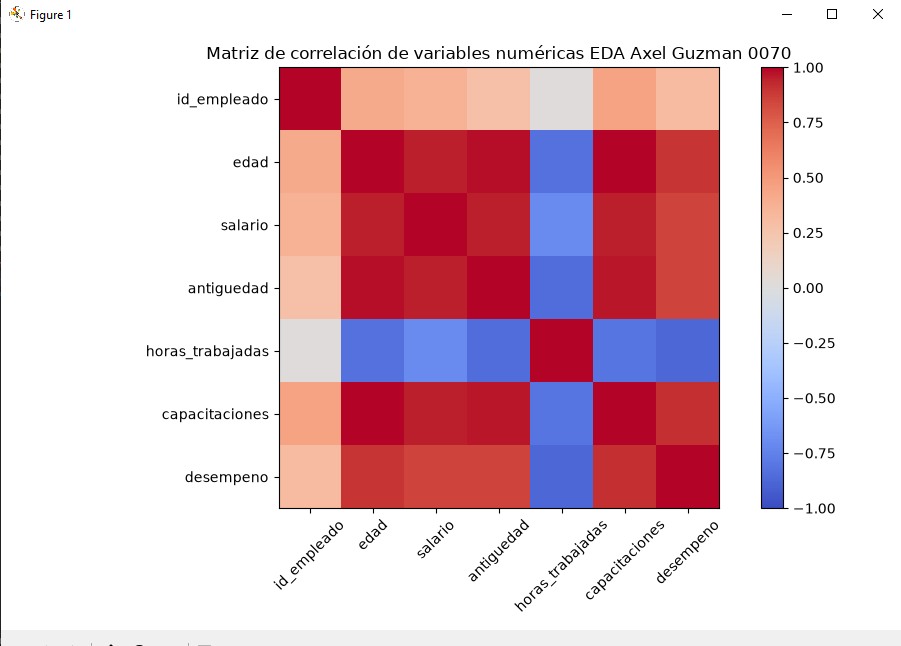

# 📊 UIII Act3: Importación y Descripción de Datos
## Axel Guzman NC 0070
> **📈 Dificultad:** Cero a principiante  
> **🐍 Lenguaje:** Python  
> **🛠️ Herramientas:** Visual Studio Code, Pandas, Matplotlib y CSV  
## tabla original de empleados

## empleados de industria

## 7 convertir el dataframe en arcivo CSV

## datos en CVS > base de datos

## leer los datos desde el archivo CVS

## 9. Análisis Exploratorio de Datos (EDA)
### primeros y ultimos registros

## 6. dimensiones y estructura

## 7 estadisticas y limpieza

# 8 y 9 ordemamiento, filtrado y agrupacion

## 18. Gráfica de barras: Empleados por departamento

# 19. Gráfica de barras: Salarios por empleado

# 20. Histograma: Distribución de edades

# 21. Gráfica de dispersión: Edad vs Salario

# 22. Diagrama de caja: Distribución de salarios

# 23. Matriz de correlación
